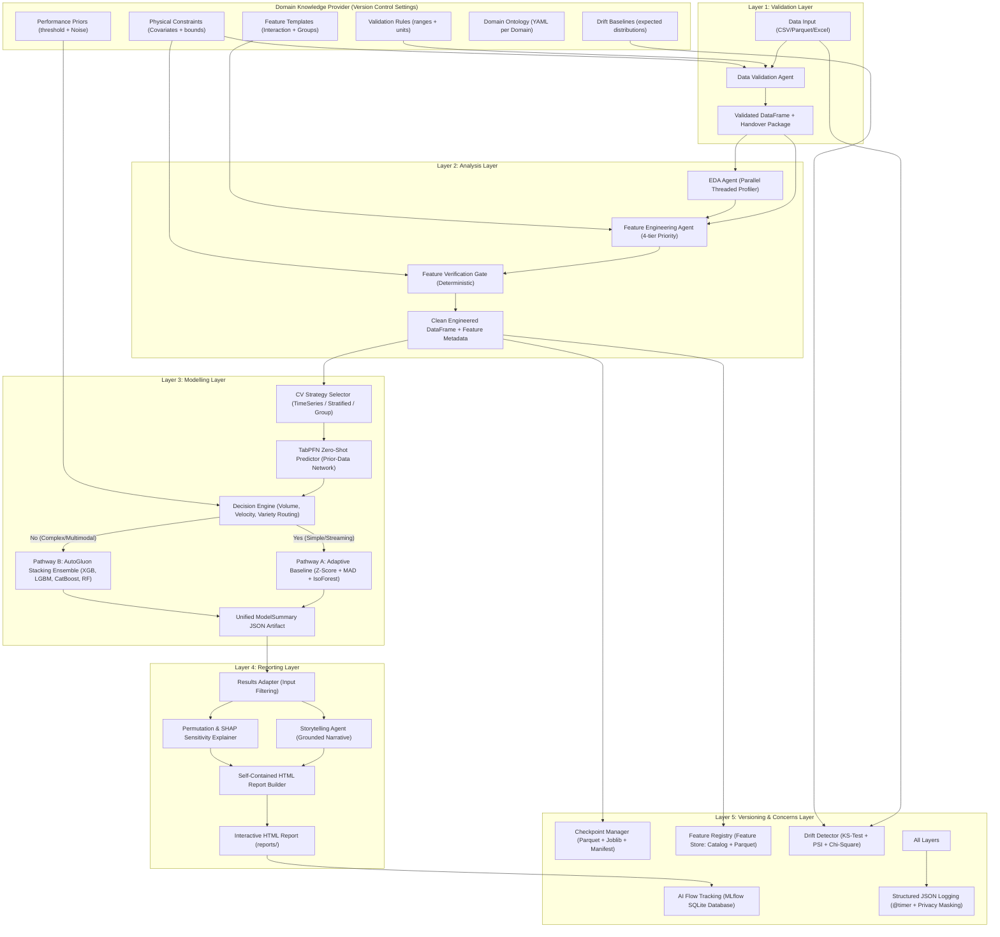

# ⚡ Predictive analysis Agentic AI Framework: End-to-End Autonomous Predictive Analytics

[](https://www.python.org/)
[](#architecture-overview)
[](https://streamlit.io/)
[](#layer-3-modelling-layer)
[](LICENSE)

An enterprise-grade, agentic machine learning platform designed for autonomous tabular and time-series anomaly detection. Built upon a 5-layer decoupled architecture with a centralized **Domain Knowledge Provider**, the system ingests raw datasets, validates data integrity, performs parallel exploratory data analysis, plans and verifies safe feature engineering, trains candidate models with dynamic routing, generates grounded narrative HTML reports, and tracks experiments with checkpoints and drift monitoring.

---

## 🗺️ Architecture Overview

The system strictly divides cognitive tasks ("what to do", planned by agentic logic) from deterministic execution ("how to compute", executed by verified Python routines).



---

## 🔬 A-to-Z Deep Dive on Each Layer

### 📋 Layer 1: Validation Layer (Data Quality Gate)
- **Objective**: Prevent contaminated or invalid data from reaching downstream modeling.
- **Inspectors**:
  - `SchemaValidator`: Enforces required columns, identifies duplicate column names, ensures non-empty rows, and validates expected data types.
  - `NullValidator`: Evaluates missing values per column against threshold limits (e.g., 5%) and flags completely empty columns.
  - `DomainValidator`: Queries the **Domain Knowledge Provider** to enforce acceptable physical ranges (units, minimums, maximums) and hard physical boundaries (e.g., non-negativity for voltage, pressure, and current).
- **Output Verdict**: Strict triple-state policy: `PASS`, `WARNING`, or `FAIL`. Halts execution if any critical schema check fails.

### 🔬 Layer 2: Analysis Layer (Parallel EDA & Safe Feature Engineering)
- **Objective**: Profile distributions and engineer explainable features while strictly forbidding arbitrary code execution.
- **Core Components**:
  - `EDAAgent`: Runs 8 concurrent profiling routines (overview, quality, numerical moments, categorical frequencies, target imbalance ratio, multivariate correlation matrix, IQR-based outliers, and temporal gap checks).
  - `DSLExecutor`: Safe domain-specific language engine supporting only whitelisted operations: `log1p`, `sqrt`, `square`, `ratio`, `multiply`, `add`, `subtract`, `bin`, `group_agg`, `datetime_part`, `clip`, and `drop`.
  - `FeatureEngineeringAgent`: Plans features via a 4-tier priority hierarchy:
    1. *User Overrides* (highest priority)
    2. *Domain Feature Templates* (physical interactions: $P = V \times I$, $R = V / I$, thermal differentials)
    3. *LLM / EDA Recommendations* (log-transforms for skewed distributions, interaction ratios)
    4. *Automatic Defaults* (diurnal time components, quantiles)
  - `FeatureVerificationGate`: Fully deterministic (no LLM) 11-step audit checking row count preservation, index alignment, infinite values (`np.isinf`), constant columns, collinear duplicates ($|r| > 0.999$), and target leakage ($|r| \ge 0.98$ or target in feature inputs) with an automated repair loop.

### 🧠 Layer 3: Modelling Layer (Autonomous Anomaly ML Engine)
- **Objective**: Dynamically adapt modeling to any tabular or time-series dataset.
- **Workflow Blocks**:
  - **Dynamic Holdout Validation**: Isolates a blind 20% holdout partition before any model sees data to ensure zero leakage.
  - **CV Strategy Selector**: Inspects dataset properties to pick the optimal cross-validation strategy: `TimeSeriesSplit` for chronological sequences, `StratifiedKFold` for severe imbalance ($<15\%$ anomalies), or `GroupKFold` for multi-device/user data.
  - **TabPFN Zero-Shot Predictor**: Employs a prior-data fitted transformer network to deliver instant probabilistic anomaly scores and 95% Bayesian credible intervals in milliseconds without long training loops.
  - **Decision Engine (Routing Gate)**: Evaluates Volume, Velocity, and Variety against Domain Knowledge:
    - *Pathway A (Adaptive Baseline)*: For simple/streaming continuous streams; computes rolling Z-scores, Median Absolute Deviation (MAD), and Isolation Forest.
    - *Pathway B (AutoGluon Ensemble)*: Powerhouse multi-model stacking combining **LightGBM**, **XGBoost**, **CatBoost**, and **Random Forest**.
  - **Unified Model Summary**: Formats predictions into a standardized JSON artifact with metrics (`PR-AUC`, `ROC-AUC`, `F1-Score`, `Recall`), anomaly thresholds, and feature importance rankings.

### 📊 Layer 4: Reporting Layer (Explainability & Grounded Storytelling)
- **Objective**: Translate raw metrics and arrays into a transparent, self-contained executive HTML report.
- **Components**:
  - `ResultsAdapter`: Harmonizes all upstream outputs, validates completeness, and flags missing metrics as `"unavailable"`.
  - `StorytellingAgent`: Produces a structured narrative using strict **Trust Rules**:
    - Grounded verbatim in verified numbers (zero hallucination).
    - Prohibits false causal claims (*"X caused Y"*) and future performance guarantees.
    - Explicitly states evaluation split constraints.
  - `SHAPExplainer`: Computes permutation feature sensitivity and Shapley attributions with prominent disclaimers separating model association from empirical causation.
  - `HTMLReportBuilder`: Compiles an interactive, dark-themed HTML report (embedded in [`reports/`](file:///d:/predictive_framework/reports/)) with metric badges, model comparison scorecards, feature importance charts, and artifact links.

### 🛡️ Layer 5: Versioning and Concerns Layer (Operational Integrity)
- **Objective**: Maintain an auditable experiment trail, guard against runtime interruptions, and detect data drift.
- **Subsystems**:
  - **AI Flow Tracking (MLflow)**: SQLite tracking database (`experiments/mlflow_tracking.db`) recording run IDs, parameters, metrics, model artifacts, and **MD5 dataset integrity hashes**.
  - **Checkpoint Manager (Resume from Failure)**: Serializes intermediate dataframes as **Parquet** (for speed and strict typing) and models with **Joblib**, updating atomic `checkpoint_manifest.json` files after every layer.
  - **Drift Detection (ML-Divergence)**: Non-parametric monitoring comparing inference batches against baseline training distributions using:
    - **Kolmogorov-Smirnov (KS-test)** for numeric distribution shifts ($p < 0.05$).
    - **Population Stability Index (PSI)** ($\text{PSI} \ge 0.20$ triggers drift alert).
    - **Chi-Square** contingency tables for categorical drift.
  - **Structured Logging**: Outputs machine-readable JSON logs (`experiments/structured_logs.jsonl`) with `@timer` execution metrics and regex data masking for privacy (PII, emails, phone numbers).
  - **Feature Registry (Feature Store)**: Centralized catalog (`feature_store/catalog.json`) persisting column data as compressed Parquet files, eliminating training-serving skew.

---

## 📂 Project Repository Structure

```
d:\predictive_framework\
├── domain_knowledge/                  # Central rules repository
│   ├── validation_rules/              # Ranges, units, required columns
│   ├── physical_constraints/          # Physical bounds & non-negativity rules
│   └── feature_templates/             # Domain interactions, bins, and groups
├── layer1_validation/                 # Layer 1: Data Validation & Quality Gate
│   ├── base_validator.py              # Base contract
│   ├── schema_validator.py            # Structural checks
│   ├── null_validator.py              # Missingness thresholds
│   ├── domain_validator.py            # Physical constraints
│   └── validation_engine.py           # Layer 1 coordinator
├── layer2_analysis/                   # Layer 2: Parallel EDA & Safe Features
│   ├── eda_agent.py                   # Multi-threaded profiler
│   ├── dsl_executor.py                # Whitelisted safe operation executor
│   ├── feature_engineering_agent.py   # 4-tier priority feature planner
│   ├── verification_gate.py           # Deterministic gate with auto-repair
│   └── analysis_orchestrator.py       # Layer 2 coordinator
├── layer3_modelling/                  # Layer 3: Anomaly ML Modeling
│   ├── cv_strategy_selector.py        # Leak-free splitting selector
│   ├── tabpfn_predictor.py            # Prior-data network zero-shot inference
│   ├── decision_engine.py             # Volume/Velocity/Variety router
│   ├── adaptive_baseline.py           # Rolling Z-score / Isolation Forest
│   ├── ensemble_predictor.py          # AutoGluon Stacking: XGB, LGBM, Cat, RF
│   ├── unified_summary.py             # Standardized JSON artifact builder
│   └── modelling_orchestrator.py      # Layer 3 coordinator
├── layer4_reporting/                  # Layer 4: Traceable Reporting
│   ├── results_adapter.py             # Upstream normalization & filtering
│   ├── shap_explainer.py              # Permutation & SHAP sensitivity
│   ├── storytelling_agent.py          # Grounded narrative generator
│   ├── html_report_builder.py         # Jinja2 self-contained HTML renderer
│   └── reporting_orchestrator.py      # Layer 4 coordinator
├── layer5_versioning/                 # Layer 5: Versioning & Concerns
│   ├── experiment_tracker.py          # MLflow-compatible SQLite experiment tracker
│   ├── checkpoint_manager.py          # Parquet + Joblib failure recovery
│   ├── drift_detector.py              # KS-test & PSI drift detection monitor
│   ├── structured_logger.py           # JSON logger with @timer & data masking
│   ├── feature_registry.py            # Lightweight Parquet Feature Store
│   └── versioning_orchestrator.py     # Layer 5 coordinator
├── data/                              # Benchmark & sample datasets
│   ├── sample_high_voltage_power.csv  # 1,200 industrial sensor telemetry records
│   └── sample_financial_fraud.csv     # 1,500 transaction records with velocity surges
├── reports/                           # Output HTML reports generated by Layer 4
├── checkpoints/                       # Intermediate stage checkpoints & manifests
├── feature_store/                     # Registered feature columns (Parquet) & catalog
├── experiments/                       # SQLite tracking database & structured JSON logs
├── tests/                             # Comprehensive test suite
│   └── run_all_tests.py               # 15 automated unit & integration tests
├── app.py                             # Interactive Streamlit Web UI (5-Layer Platform)
├── run_pipeline.py                    # CLI end-to-end 5-layer pipeline runner
├── run_ui.bat                         # 1-Click Windows batch launcher
├── run_ui.ps1                         # 1-Click PowerShell launcher
└── requirements.txt                   # Dependency manifest
```

---

## 🚀 Getting Started

### 1. Prerequisites
- Python 3.10 or higher.
- Windows, Linux, or macOS.

### 2. Installation
Clone the repository and install dependencies:
```bash
git clone https://github.com/yuvarajr-2007/predictive_analysis_framework.git
cd predictive_analysis_framework
pip install -r requirements.txt
```

### 3. Launching the Interactive Web UI
Launch the application with a single command:
- **Windows (Command Prompt / Double Click)**:
  ```cmd
  run_ui.bat
  ```
- **Windows (PowerShell)**:
  ```powershell
  .\run_ui.ps1
  ```
- **Direct Python**:
  ```bash
  python -m streamlit run app.py
  ```
Open **[http://localhost:8501](http://localhost:8501)** in your browser.

---

## 💻 CLI & Headless Pipeline Execution

To run the complete 5-layer autonomous pipeline from the command line:
```bash
python run_pipeline.py
```

### Output Execution Log
```text
================================================================================
[RUN] EXECUTING FULL ANOMALY AGENTIC AI FRAMEWORK (LAYERS 1 -> 5)
================================================================================

[1] Ingesting dataset from: d:/predictive_framework/data/sample_high_voltage_power.csv
    Loaded 1200 rows and 9 columns.

----------------------------------------
[LAYER 1] VALIDATION LAYER
----------------------------------------
    Verdict: PASS
    Checks run: ['SchemaValidator', 'NullValidator', 'DomainValidator']
    Total issues flagged: 0

----------------------------------------
[LAYER 2] ANALYSIS LAYER
----------------------------------------
    Analysis Status: PASSED
    Engineered Columns Planned: 10
    Feature Verification Gate: PASSED

----------------------------------------
[LAYER 3] MODELLING LAYER
----------------------------------------
    Modelling Status: COMPLETED
    Champion Model Selected: AutoGluon_Ensemble
    CV Strategy Selected: TimeSeriesSplit
    ROC-AUC: 1.0000 | PR-AUC: 1.0000
    Anomalies Flagged: 15 / 240 (6.25%)

----------------------------------------
[LAYER 4] REPORTING LAYER
----------------------------------------
    Reporting Status: COMPLETED
    Generated HTML Report: reports/run-59168918_report.html
    Executive Narrative Grounded: True

----------------------------------------
[LAYER 5] VERSIONING & CONCERNS LAYER
----------------------------------------
    Versioning Status: RECORDED
    Dataset Hash (MD5): 6c52515fb1a04c14738f8e6f285c8203
    Checkpoint Manifest: checkpoints/run-59168918_manifest.json
    Features Registered in Feature Store: 10
    Drift Detection Baseline Check: Drift Alert = False (0 drifted features)

================================================================================
[SUCCESS] ALL 5 LAYERS EXECUTED SUCCESSFULLY WITH FULL TRACEABILITY!
================================================================================
```

---

## 🧪 Automated Test Suite

Run the full automated test suite covering all 5 layers:
```bash
python tests/run_all_tests.py
```

**15 of 15 tests pass with zero errors:**
- `TestLayer1Validation`: Clean schemas, missing columns, null limits, physical boundary checks.
- `TestLayer2Analysis`: Threaded EDA, DSL math executors, target leakage rejection.
- `TestLayer3Modelling`: Chronological cross-validation, volume/variety decision routing.
- `TestLayer4Reporting`: Storytelling agent narrative checks, self-contained HTML generation.
- `TestLayer5VersioningAndConcerns`: MD5 dataset hashing, checkpoint save/restore, PSI/KS drift detection, Feature Store register & retrieve.

---

## 🛡️ Built-in Security & Trust Principles

1. **Deterministic Execution**: The LLM only proposes ideas (what data means, recommended transforms); ordinary, deterministic Python routines compute all statistics and transforms.
2. **Zero Code Injection**: The DSL executor only permits whitelisted operations; arbitrary code strings from external sources are rejected.
3. **Target Leakage Safeguard**: Features derived from or overly correlated with the target variable ($|r| \ge 0.98$) are detected and removed by the Verification Gate.
4. **Data Privacy**: Automatic regex data masking strips emails, phone numbers, and PII before writing structured JSON logs.
5. **No Causation Fallacy**: The reporting layer clearly disclaims that feature importance scores reflect sensitivity within the sample, preventing misleading claims of physical causation.

---

## 📄 License
This project is open-source and distributed under the [MIT License](LICENSE).
